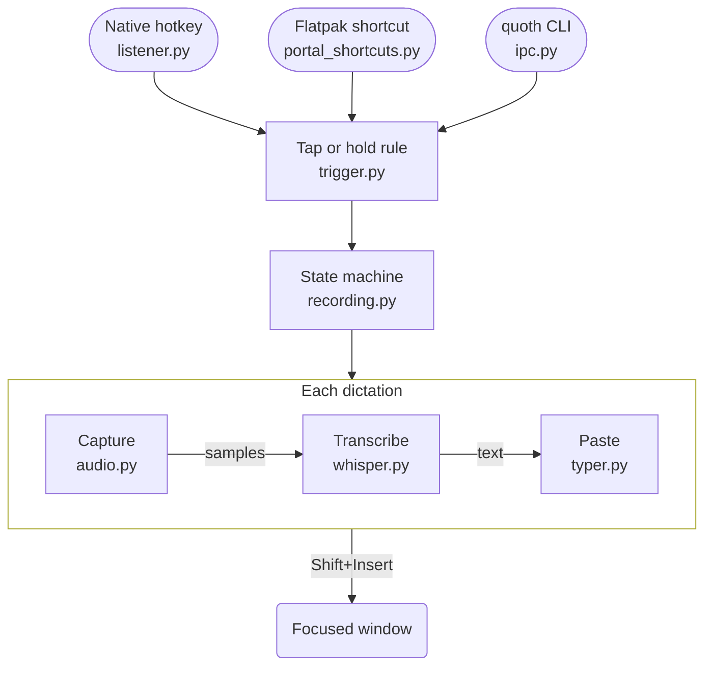

# Contributing to Quoth

Quoth is a Python 3.12+ GTK4 application. Its API floors are GTK 4.14, libadwaita
1.5 and GLib 2.80, as on Ubuntu 24.04: use no newer GTK, libadwaita or GLib API
without a version or feature check. Use `uv` for Python tooling and keep changes
focused on one demonstrated need. Shape each change so it belongs naturally in
the codebase rather than bolting on a workaround: refactor, move or remove
existing seams when that yields a cleaner whole, while keeping the
[stable interfaces](SUPPORT.md#stable-interfaces) and
[critical invariants](AGENTS.md#critical-invariants-do-not-break) intact. Prefer
extending the module that already does the job, the standard library or a
supported platform API over a new abstraction. Open an issue before starting a
larger change, so its direction can be agreed first.

Contributions are licensed under the project's GPL-3.0-or-later.

AI-assisted contributions are held to the same standard as any other: you answer
for every line, so read, understand and test what you submit. Say which parts a
tool wrote, with an `Assisted-by:` commit trailer or a line in the pull request.

## Source setup

Install these from your distribution:

- **Runtime:** GTK4, libadwaita and GStreamer with their GObject introspection
  typelibs; PyGObject with its cairo integration; the GStreamer base, good and
  PipeWire plugins; gtk4-layer-shell, wl-clipboard, wtype and ydotool; a Vulkan
  loader and driver.
- **Native builds:** a C/C++ compiler, CMake, Meson, Ninja, `pkg-config`, Vulkan
  and SPIR-V headers, glslc (shaderc), Cairo and Python development headers, `curl`,
  `patch` and GLib's `glib-compile-schemas`.
- **Tests:** `jq`, the Inter font, D-Bus, Xvfb and xauth.
- **Optional:** OpenVINO, for Intel NPU support.

On Ubuntu 24.04:

```bash
sudo apt install git gir1.2-gtk-4.0 gir1.2-adw-1 gir1.2-gstreamer-1.0 \
  python3-gi python3-gi-cairo gstreamer1.0-plugins-base gstreamer1.0-plugins-good \
  gstreamer1.0-pipewire wl-clipboard wtype ydotool libvulkan1 mesa-vulkan-drivers \
  build-essential cmake libvulkan-dev glslc spirv-headers meson ninja-build \
  libcairo2-dev python3-dev pkg-config curl patch libglib2.0-bin jq \
  libgtk-4-dev libgirepository1.0-dev fonts-inter dbus-daemon xvfb xauth
```

Ubuntu 24.04 has no gtk4-layer-shell package, so the steps below build the
pinned release into `lib/` with `make vendor-layer-shell`; that build is what
`libgtk-4-dev` and `libgirepository1.0-dev` are for. Install
[uv](https://docs.astral.sh/uv/getting-started/installation/), then build
against the repository's pinned native sources:

```bash
git clone https://github.com/abullard1/Quoth.git
cd Quoth
uv venv --python /usr/bin/python3
uv sync --locked
gi_dir=$(/usr/bin/python3 -c 'import gi, os; print(os.path.dirname(gi.__file__))')
site=$(.venv/bin/python -c 'import sysconfig; print(sysconfig.get_path("purelib"))')
ln -s "$gi_dir" "$site/gi"
. packaging/pins.sh
curl -fsSLo /tmp/whisper.tar.gz \
  "https://github.com/ggml-org/whisper.cpp/archive/refs/tags/$QUOTH_WHISPER_TAG.tar.gz"
echo "$QUOTH_WHISPER_SHA256  /tmp/whisper.tar.gz" | sha256sum -c -
mkdir "$HOME/whisper.cpp"
tar xzf /tmp/whisper.tar.gz -C "$HOME/whisper.cpp" --strip-components=1
bash scripts/apply_whisper_patches.sh --apply "$HOME/whisper.cpp"
make build
make vendor-layer-shell   # only where the distribution lacks gtk4-layer-shell
make vendor-thorvg
make schemas
uv run pre-commit install
uv run quoth
```

- Linking only `gi` makes the distribution's bindings available without
  importing unrelated system packages or pytest plugins.
- To build an existing whisper.cpp checkout, run
  `WHISPER_DIR=/path/to/whisper.cpp make build`. An NPU build also sets
  `WITH_OPENVINO=ON` and points `OpenVINO_DIR` at the runtime's CMake package.
- `make build` checks that every tracked whisper.cpp patch is applied, so after
  changing the pinned source, run the patch helper on that checkout.
- `make schemas` compiles `data/dev.quoth.Quoth.gschema.xml` into
  `data/gschemas.compiled`, where a source run finds it. Rerun it after editing
  the schema.
- These commands run Quoth from the checkout. They install no desktop files or
  device permissions.

For everyday development, bind a desktop shortcut to
`uv run --directory /absolute/path/to/quoth quoth --toggle`. Native evdev capture
also needs `/dev/input` read access; join the `input` group only to test that path,
for the reasons in
[Permissions and known limitations](SUPPORT.md#permissions-and-known-limitations).

## Core local checks

Run these before opening a pull request:

```bash
uv run pytest
uv run ruff check .
uv run ruff format --check .
uv run lint-imports
uv run zizmor .    # when a workflow changed
```

CI also checks coverage, shell scripts, packaging-pin parity, locked dependency
audits, desktop/AppStream metadata, and package builds. The workflows under
`.github/workflows/` run all of these; CodeQL code scanning runs separately,
through GitHub's default setup.

A change to a workflow's `uses:` line also needs `.github/workflows/actions.lock`
regenerated with `gh actions-lock --no-narrow` (the `github/gh-actions-lock`
extension). With a stale lockfile the workflow fails to start, and no check on
the pull request shows it.

`lint-imports` enforces the architecture in `pyproject.toml`. Every module sits in
one of six tiers by meaning (entry, app, ui, services, adapters, domain) and may
import only its own tier and the ones below, without cycles. Further contracts keep
GTK out of the logic tiers and name the only modules that may use `sentry_sdk`,
evdev, ctypes, subprocess and the network. If a change needs an import the contract
forbids, change the design or discuss the contract instead of bypassing it.

## Tests

A behaviour change or bug fix comes with a test that fails without it, and a
test deleted, skipped or weakened says why in the pull request.
Tests live under `tests/`, normally one file per module. Without a display,
`tests/conftest.py` skips the widget tests; the rest runs headless. On X11 and
headless runs, shared fixtures treat layer-shell as unavailable; overlay tests
opt in to the `layer_shell` fake. CI runs the whole suite on a virtual display
and enforces coverage there; a headless run covers less. To run it as CI does,
with the desktop lab's lifecycle tests after it:

```bash
dbus-run-session -- xvfb-run -a env GDK_BACKEND=x11 GSK_RENDERER=cairo GTK_A11Y=test \
  uv run --locked --group icons pytest -ra --cov=quoth
uv run --locked --project lab pytest lab/test_lifecycle.py
```

A GLib or GTK callback that raises, such as a draw function, fails the test
that ran it. Tests run in a random order, so each sets up what it needs. The run's
header names the seed (`-q` hides it): pass `--randomly-seed=N` to repeat that
order, or `-p no:randomly` to keep the file order.

Shared fakes and helpers live in `tests/support/`. A few conventions keep the tests
alike and honest:

- Test what a caller or user can observe, not how the code is arranged today, so a
  refactor that keeps the behaviour keeps its tests.
- Prefer a fake at a seam (`Scheduler`, `TranscriptionBackend`, `AudioBackend`) over
  patching internals. Double our other classes with `create_autospec(Cls,
  instance=True)`, so calling a method that no longer exists fails, and use a real
  `Config()`: settings run on GIO's memory backend and reset after each test.
- Use the real thing where it is cheap and needs nothing from the host: the
  `private_bus` fixture for D-Bus, an `audiotestsrc` graph for capture.
  `tests/test_support.py` checks the fakes of Quoth's own classes against the real
  ones, so a fake changes with its class.
- Assert logs through pytest's `caplog`, which `conftest.py` feeds from loguru, not a
  patched `logger`: a patched logger never formats its message, so a broken placeholder
  would pass.
- Wait for a condition with a deadline (`wait_until` for the main loop, `join_thread`,
  `Event.wait`), never a fixed sleep.
- Detection finds only the CPU unless a test adds a device to the `detected_devices`
  fixture, so no result depends on the machine running the suite.

## Ownership and lifecycle

Every hotkey source goes through one tap-or-hold rule, and the recording state
machine runs each dictation from capture to paste:



- `app.py` composes the application and owns component lifecycle (starting inputs, engine and dependents cleanly, and tearing down in reverse order on shutdown). `recording.py` owns the `IDLE -> RECORDING -> TRANSCRIBING -> IDLE` state machine.
- [Architecture](AGENTS.md#architecture) in AGENTS.md outlines the layers and key ownership seams; module docstrings and `pyproject.toml` hold the live module map. Error reports carry only what [PRIVACY.md](PRIVACY.md#error-reports) lists.
- A config-key change starts in `data/dev.quoth.Quoth.gschema.xml`, the single source of keys, defaults and valid values, and flows through `Config` and its Settings UI row. Running instances must apply config changes immediately (verified in `tests/test_app.py`).
- Everything [Stable interfaces](SUPPORT.md#stable-interfaces) in SUPPORT.md lists stays backwards-compatible: add to it, but never rename, retype or narrow it.
- Adding an inference device spans hardware detection, backend resolution/fallback rules (`accel.py`), schema choices, and onboarding backend presentation.
- Adding an overlay theme key spans theme loading (`theme.py`), overlay drawing (Pill or Orb views), bundled theme presets under `src/quoth/themes/`, and the table in [SUPPORT.md](SUPPORT.md#customise-quoth).
- The C shim (`lib/whisper_helper.c`) and ctypes bindings (`whisper.py`) change together and rebuild via `make build`.
- Icons and earcons are generated, never hand-edited. Regenerate icons from `data/icons/src/` with `uv run --group icons python scripts/generate_icons.py`, and earcons in `src/quoth/sounds/` with `uv run python scripts/generate_sounds.py`.

Every change keeps the
[critical invariants](AGENTS.md#critical-invariants-do-not-break) and
[code conventions](AGENTS.md#conventions) in AGENTS.md; they apply to every
contributor, not only coding agents. Keep errors at their existing boundary.

## Debugging

- `QUOTH_LOG_LEVEL=DEBUG uv run quoth` shows lifecycle and device detection.
  Disk logs are under `$XDG_STATE_HOME/quoth/`. Do not use TRACE with private
  dictation because it prints transcript text to the console.
- `GTK_DEBUG=interactive uv run quoth` opens the GTK inspector, as does GTK's
  own <kbd>Ctrl</kbd>+<kbd>Shift</kbd>+<kbd>D</kbd> in a running Quoth.
- `QUOTH_FORCE_ONBOARDING=1 uv run quoth` replays first-run setup. Quit the
  current instance first with `uv run quoth -q`.
- `uv run quoth --settings` opens Settings directly.
- `QUOTH_UPDATE_API_URL=https://example.org/latest uv run quoth` points the update
  check at another endpoint that answers like GitHub's latest-release API (a JSON
  `tag_name`), for a fork, a mirror or a test. **Check now** in Settings uses it
  at once; the automatic check runs only while **Check for updates** is on, once
  when it is turned on and then at most daily. **View release** still opens
  Quoth's latest release on GitHub.
- Use throwaway settings, config and state without replacing real models:

  ```bash
  GSETTINGS_BACKEND=keyfile \
  XDG_CONFIG_HOME=/tmp/quoth-dev/config \
  XDG_STATE_HOME=/tmp/quoth-dev/state \
  uv run quoth
  ```

  Without the keyfile backend, settings go to your real dconf database whatever
  `XDG_CONFIG_HOME` says. Remove `/tmp/quoth-dev` when finished.
- `scripts/simulate_overlay_states.py` plays the overlay's states without a
  dictation. `scripts/debug_audio.py` records through the app's capture pipeline
  and reports levels.
- [`lab/`](lab/README.md) checks that a desktop's input and audio capture are
  ready for testing, in disposable virtual machines without Quoth installed.

## Commits and documentation

Use Conventional Commit subjects (`feat(scope):`, `fix(scope):`, `test:`,
`docs:`), one concern per commit. Explain the behaviour, reason, and checks in the
pull request. Update SUPPORT.md or the README when user-visible behaviour
changes. Write documentation in British English, in short plain sentences
without em dashes, and give each fact one home that others link to. Pull
requests to `main` need passing checks and resolved review conversations.

Participation follows the [Code of Conduct](CODE_OF_CONDUCT.md). Visual changes
should follow [DESIGN.md](DESIGN.md). Report security vulnerabilities privately,
as [SECURITY.md](SECURITY.md) describes, not in a public issue.
